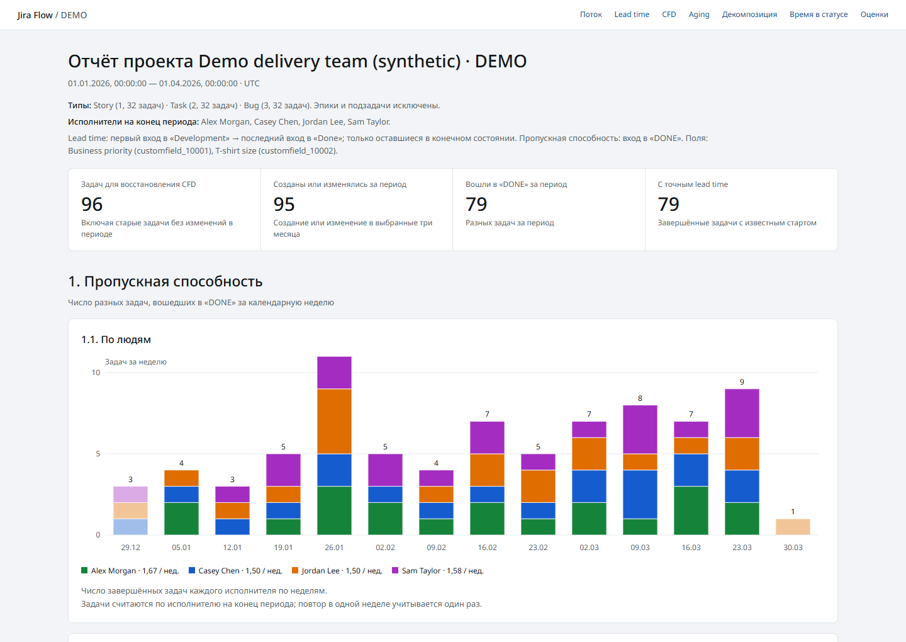
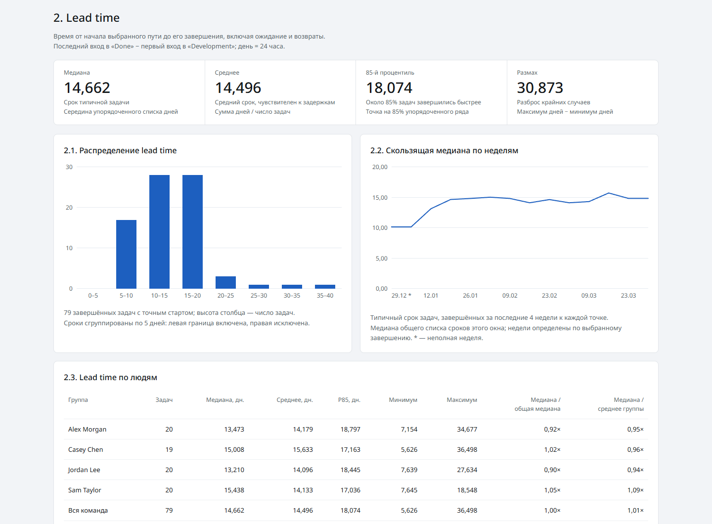
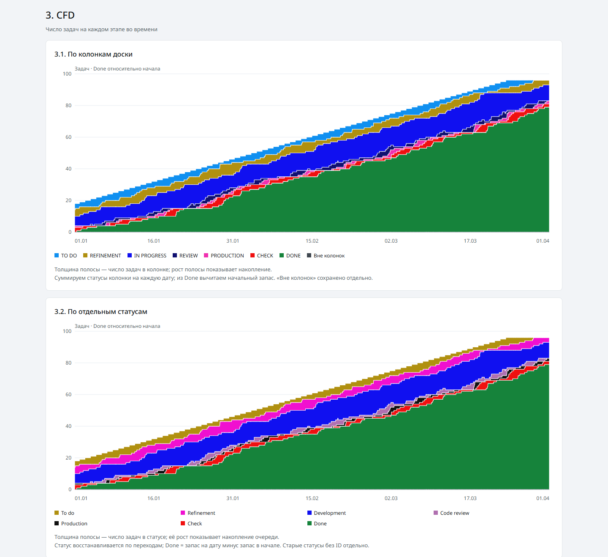

<h1 align="center">Jira Flow Report</h1>
<p align="center"><strong>Understand how work moves through your Jira board.</strong><br>Configurable flow metrics, complete issue histories and a dashboard you can share as one HTML file.</p>
<p align="center"><strong>English</strong> · <a href="README.ru.md">Русский</a></p>
<p align="center">
<a href="LICENSE"></a>
<a href="pyproject.toml"></a>
<a href="#try-the-demo"></a>
</p>



For delivery leads, engineering managers and teams reviewing queues, long-running work and delivery times.
Choose a project, issue types, people, period and workflow in YAML. Python reconstructs the histories;
the generated report embeds its data, charts, styles and fonts and works offline.

**Seven sections · nine charts · one reusable template.** The current report interface is in Russian;
configuration comments and this guide are in English. There is no Node.js build or hosted service.

[Try the demo](#try-the-demo) · [Connect Jira](#connect-your-jira) · [Configuration](#configuration)
· [Metric definitions](docs/metrics.md) · [Contributing](CONTRIBUTING.md)

## What you can inspect

| Section | Questions it helps answer |
| --- | --- |
| **Throughput** | How many distinct issues reach completion each week? Split by person, type and business priority. |
| **Lead time** | How long does delivery take? Distribution, rolling median, P85 and group comparisons. |
| **Cumulative flow (CFD)** | Where does work accumulate? Separate diagrams for board columns and Jira statuses. |
| **Aging time** | How long do completed passages through each stage take? Compare people and stage means. |
| **Decomposition** | How often are issues split? Inspect child counts, depth and long-running unsplit work. |
| **Time in status** | Which open issues exceed the completed average for their current status, measured from first entry? |
| **Estimates** | How do estimates relate to delivery time? Bubble area shows frequency; ordinal sizes stay ordinal. |

<details>
<summary><strong>Lead-time distribution and rolling median</strong></summary>



</details>

<details>
<summary><strong>Cumulative flow by board column and status</strong></summary>



</details>

Screenshots use the real template and fictional histories from [examples/demo.py](examples/demo.py).
No customer data is used.

## Try the demo

Install [uv](https://docs.astral.sh/uv/getting-started/installation/) and Git.
The package requires Python 3.12+; `uv` uses the development version pinned in `.python-version`.

```sh
git clone https://github.com/letya999/jira-flow-report.git
cd jira-flow-report
uv sync --locked
uv run --locked python examples/demo.py
```

The command prints an `output` directory. Open its `report.html` directly in your browser.
No Jira account, token or `.env` is needed. The demo generates 96 fictional issues across four people
and uses the same calculation and rendering code as a live report.

For a local viewer, replace the directory below with the printed path:

```sh
uv run --locked jira-flow serve --directory output/DEMO-<timestamp> --port 0
```

The viewer prints a free `127.0.0.1` URL. Stop it with Ctrl+C.

## Connect your Jira

### 1. Create local settings

Copy the examples once; keep any existing local files.

```sh
cp .env.example .env
cp configs/example.yaml configs/local.yaml
```

<details>
<summary>PowerShell</summary>

```powershell
if (!(Test-Path .env)) { Copy-Item .env.example .env }
if (!(Test-Path configs/local.yaml)) { Copy-Item configs/example.yaml configs/local.yaml }
```

</details>

Set `JIRA_BASE_URL`, `JIRA_EMAIL` and `JIRA_API_TOKEN` in `.env` or process variables.
Use a Jira Cloud account with read access to the project and its histories.
Process variables take precedence; choose another file with `--env-file`.
The extractor reads Jira data and does not modify issues.

### 2. Map your actual workflow

The example contains **synthetic IDs**. Replace the project key, issue type IDs, field IDs,
status-to-column mapping, metric boundaries and period before contacting Jira.
Use Jira IDs, not translated field or status names.

```yaml
assignee_ids: []  # All assignees; use Jira account IDs to select a team/person.
jira:
  project_key: DEMO
  issue_type_ids: ["1", "2", "3"]  # Replace with your Story/Task/Bug IDs.
  board_id: null
fields:
  priority_id: customfield_10001
  assignee_id: assignee
  estimate_id: customfield_10002
period:
  start: "2026-01-01T00:00:00+00:00"
  end: "2026-04-01T00:00:00+00:00"
  timezone: UTC
```

This is an excerpt: keep the column and metric sections from [configs/example.yaml](configs/example.yaml).
English comments explain every setting. Only selected issue types enter flow metrics;
other types may be retrieved as hierarchy records to establish decomposition.

### 3. Generate the report

```sh
uv run --locked jira-flow config --config configs/local.yaml
uv run --locked jira-flow run --config configs/local.yaml
```

`config` validates and prints settings without contacting Jira. `run` fetches data and prints a JSON
summary with the output directory and sample counts. Large projects can take time: CFD needs
initial inventory, and decomposition needs project-wide hierarchy records.

## Configuration

Keep one local YAML per team or person and select it with `--config`.
An empty `assignee_ids` includes everyone; otherwise selection uses account IDs at the period end.
Only `configs/example.yaml` is tracked. Concrete configs and report runs stay local.

| Setting | Controls |
| --- | --- |
| `jira`, `assignee_ids` | Project, issue types, optional board validation and people. |
| `fields` | Priority, assignee and estimate field IDs; `assignee` is a canonical system field ID. |
| `period` | Inclusive start, exclusive end and time zone for weekly boundaries. |
| `columns` | Ordered columns and their status IDs. Labels only change displayed text. |
| `metrics.throughput`, `metrics.lead_time` | Independent start/end boundaries and lead-time event rules. |
| `metrics.aging`, `metrics.cfd` | Duration method and Done column to shift to zero on charts. |
| `metrics.decomposition` | Split-link type IDs in addition to parent/child relations. |
| `metrics.estimate_accuracy` | Units/options, covered columns, frequency bins and working calendar. |

Override settings without editing YAML:

```sh
uv run --locked jira-flow run --config configs/local.yaml --set metrics.lead_time.rolling_weeks=6
```

Repeat `--set dotted.path=value`. JSON values support lists, objects, numbers, booleans and null.
IDs remain strings. Lists replace the previous list; `columns` replaces the entire mapping.
Unknown settings, duplicate status mappings and timestamps without offsets are rejected.
YAML paths are relative to the file; CLI paths are relative to the current directory.
YAML is optional if `--set` supplies all required values. Python callers can use `load_config()`
and `run_report()` from `jira_flow.config` and `jira_flow.report`.

## What a run produces

```text
output/DEMO-<UTC timestamp>/
├── report.html                   # Self-contained dashboard
├── issues.json                   # Issues, histories and hierarchy
├── issues.csv                    # One issue per row, with serialized histories
├── metrics.json                  # Metrics, cohorts, exclusions and validation
└── config_DEMO_<timestamp>.yaml   # Effective settings, without credentials
```

Send `report.html` to recipients authorized to see its data. Keep the other files for audit and
recalculation. Each run creates a new directory; a failed build does not publish a partial report.

Rebuild from a snapshot without Jira:

```sh
uv run --locked jira-flow build --config configs/local.yaml --input output/DEMO-<timestamp>/issues.json
```

The snapshot must cover the requested project, types, people and fields. Changing the period end
requires a fresh extraction: exported membership is fixed at that cutoff.

## Read the numbers correctly

- Metrics reconstruct state at the selected cutoff. Reopenings and pre-period history matter.
- Throughput counts each issue once per local week; a later-week reclosure can count again.
- Lead time follows configured events; it is not automatically a sum of time in selected columns.
- Open issues are excluded from completed Aging means and compared against them separately.
- Estimates are frozen before their scope starts. T-shirt sizes and story points are never converted to hours.
- Person groups describe assigned issues, not individual effort or productivity.
- Missing starts, restricted children and unresolved histories remain exclusions or unknowns, never invented zeros.

See [metric definitions](docs/metrics.md) for formulas, cohorts and checks.
The HTML is currently Russian-only. Jira Server/Data Center and alternative authentication methods
have not been verified; live extraction targets Jira Cloud.

## Develop and contribute

```sh
git config core.hooksPath .githooks
uv run --locked pytest
uv run --locked ruff check src tests examples .githooks .repo-safety/scripts
uv build
```

Tests and the demo use synthetic histories. CI checks Linux and Windows without Jira secrets or report uploads.
`main` is the only permanent branch; commits use `type(scope): description`. Coauthor trailers are prohibited.
See [CONTRIBUTING](CONTRIBUTING.md) and [agent rules](AGENTS.md).

## Privacy and license

Real configs, caches, exports and reports contain internal data and are excluded from Git.
A report without an API token can still contain sensitive information. See [SECURITY](SECURITY.md).

Code and documentation: [MIT](LICENSE). Embedded Noto Sans: [SIL Open Font License 1.1](src/jira_flow/assets/OFL-Noto-Sans.txt),
also included in generated HTML. Independent community project; not affiliated with Atlassian.
