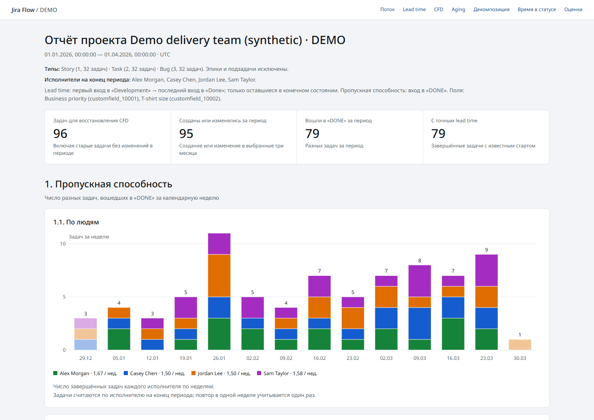
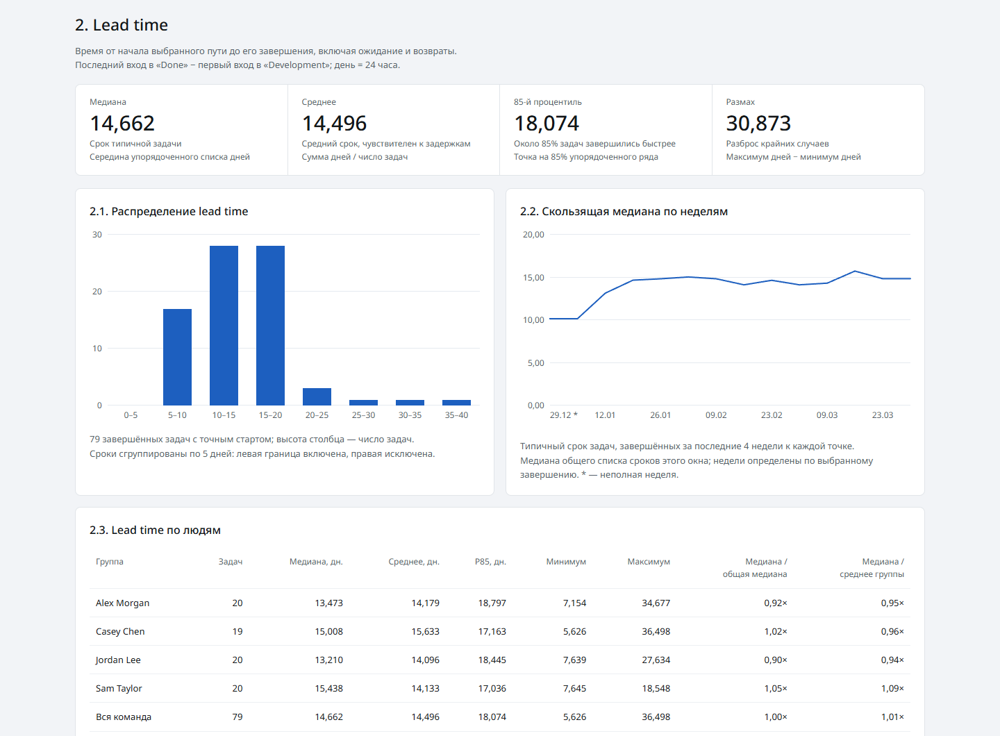
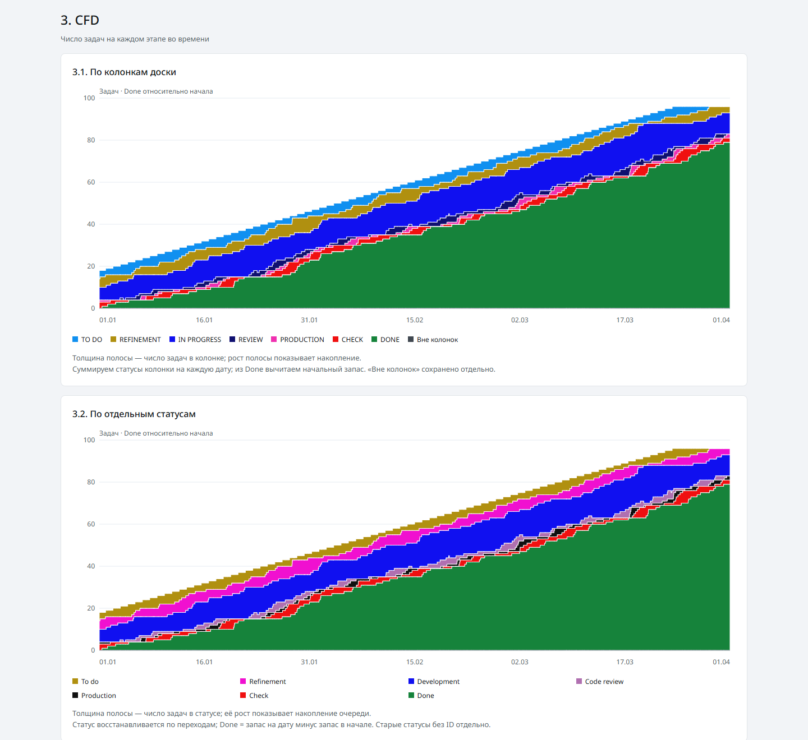

<h1 align="center">Jira Flow Report</h1>
<p align="center"><strong>Посмотрите, как задачи проходят через вашу доску Jira.</strong><br>Настраиваемые метрики потока, полная история задач и дашборд, который можно передать одним HTML-файлом.</p>
<p align="center"><a href="README.md">English</a> · <strong>Русский</strong></p>
<p align="center">
<a href="LICENSE"></a>
<a href="pyproject.toml"></a>
<a href="#попробовать-демо"></a>
</p>



Для руководителей разработки, delivery-менеджеров и команд, которые разбирают очереди, долгие задачи
и сроки доставки. Задайте проект, типы задач, людей, период и воркфлоу в YAML. Python восстановит
истории; готовый отчёт содержит данные, графики, стили и шрифт и работает без интернета.

**Семь разделов · девять графиков · один шаблон для разных команд.** Интерфейс отчёта — на русском,
комментарии в конфиге — на английском. Сборка Node.js и отдельный облачный сервис не нужны.

[Попробовать демо](#попробовать-демо) · [Подключить Jira](#подключить-свою-jira)
· [Настройки](#настройки) · [Правила расчёта](docs/metrics.ru.md) · [Участие в проекте](CONTRIBUTING.md)

## Что можно разобрать

| Раздел | На какие вопросы отвечает |
| --- | --- |
| **Пропускная способность** | Сколько разных задач завершают за неделю? Разбивка по людям, типам и бизнес-приоритетам. |
| **Lead time** | Сколько занимает доставка? Распределение, скользящая медиана, P85 и сравнение групп. |
| **CFD** | Где накапливаются очереди? Отдельные диаграммы по колонкам доски и статусам Jira. |
| **Aging time** | Сколько длятся завершённые прохождения этапов? Средние по команде и людям. |
| **Глубина декомпозиции** | Насколько дробят задачи? Число детей, глубина и долго открытые задачи без декомпозиции. |
| **Время в статусе** | Какие открытые задачи с первого входа находятся в текущем статусе дольше исторического среднего? |
| **Точность оценок** | Как оценки связаны со сроками? Размер пузырька показывает частоту; T-shirt Size остаётся порядковой шкалой. |

<details>
<summary><strong>Распределение lead time и скользящая медиана</strong></summary>



</details>

<details>
<summary><strong>CFD по колонкам и статусам</strong></summary>



</details>

Скриншоты сняты с настоящего шаблона; вымышленные истории создаёт [examples/demo.py](examples/demo.py).
Данных клиентов в них нет.

## Попробовать демо

Установите [uv](https://docs.astral.sh/uv/getting-started/installation/) и Git.
Пакет требует Python 3.12+; `uv` использует версию разработки из `.python-version`.

```sh
git clone https://github.com/letya999/jira-flow-report.git
cd jira-flow-report
uv sync --locked
uv run --locked python examples/demo.py
```

Команда напечатает папку `output`. Откройте находящийся в ней `report.html` в браузере.
Аккаунт Jira, токен и `.env` не нужны. Демо создаёт 96 вымышленных задач четырёх исполнителей
и использует те же расчёты и отрисовку, что и отчёт из Jira.

Для просмотра на локальном сервере замените папку ниже на путь из вывода:

```sh
uv run --locked jira-flow serve --directory output/DEMO-<timestamp> --port 0
```

Сервер напечатает адрес `127.0.0.1` со свободным портом. Остановка — Ctrl+C.

## Подключить свою Jira

### 1. Создать локальные настройки

Скопируйте примеры один раз; существующие локальные файлы сохраняйте.

```sh
cp .env.example .env
cp configs/example.yaml configs/local.yaml
```

<details>
<summary>PowerShell</summary>

```powershell
if (!(Test-Path .env)) { Copy-Item .env.example .env }
if (!(Test-Path configs/local.yaml)) { Copy-Item configs/example.yaml configs/local.yaml }
```

</details>

Заполните `JIRA_BASE_URL`, `JIRA_EMAIL` и `JIRA_API_TOKEN` в `.env` или переменных процесса.
Нужен аккаунт Jira Cloud с правами чтения проекта и историй задач.
Переменные процесса приоритетнее `.env`; другой файл выбирается через `--env-file`.
Скрипт читает данные и не изменяет задачи Jira.

### 2. Описать реальный воркфлоу

В примере **вымышленные ID**. Перед подключением замените ключ проекта, ID типов задач,
полей и статусов, маппинг колонок, границы метрик и период. Используйте ID из Jira,
а не переведённые названия полей или статусов.

```yaml
assignee_ids: []  # Все исполнители; для команды или человека задайте Jira account IDs.
jira:
  project_key: DEMO
  issue_type_ids: ["1", "2", "3"]  # Замените на ваши ID историй, заданий и багов.
  board_id: null
fields:
  priority_id: customfield_10001
  assignee_id: assignee
  estimate_id: customfield_10002
period:
  start: "2026-01-01T00:00:00+00:00"
  end: "2026-04-01T00:00:00+00:00"
  timezone: UTC
```

Это фрагмент: сохраните секции колонок и метрик из [configs/example.yaml](configs/example.yaml).
Английские комментарии объясняют каждую настройку. В метрики потока входят только выбранные
типы задач; другие типы могут загружаться для восстановления дерева декомпозиции.

### 3. Построить отчёт

```sh
uv run --locked jira-flow config --config configs/local.yaml
uv run --locked jira-flow run --config configs/local.yaml
```

`config` проверяет и печатает настройки без обращения к Jira. `run` загружает данные и выводит
JSON с путём результата и размерами выборок. Для больших проектов загрузка может занять время:
CFD нужен начальный запас, декомпозиции — связи задач всего проекта.

## Настройки

Храните отдельный YAML для команды или человека и выбирайте его через `--config`.
Пустой `assignee_ids` включает всех; непустой — выбирает account IDs на конец периода.
В Git хранится только `configs/example.yaml`. Конкретные настройки и результаты остаются локальными.

| Настройка | Что задаёт |
| --- | --- |
| `jira`, `assignee_ids` | Проект, типы задач, необязательную проверку доски и исполнителей. |
| `fields` | ID полей приоритета, исполнителя и оценки; `assignee` — ID системного поля. |
| `period` | Включённое начало, исключённый конец и часовой пояс для недель. |
| `columns` | Порядок колонок и ID статусов. `label` влияет только на отображение. |
| `metrics.throughput`, `metrics.lead_time` | Независимые границы метрик и правила выбора событий lead time. |
| `metrics.aging`, `metrics.cfd` | Способ расчёта длительности и конечную колонку с нулевым стартом на графиках. |
| `metrics.decomposition` | ID связей разбиения в дополнение к родительским связям. |
| `metrics.estimate_accuracy` | Шкалу оценки, варианты, область колонок, интервалы частотности и рабочий календарь. |

Настройку можно переопределить без изменения YAML:

```sh
uv run --locked jira-flow run --config configs/local.yaml --set metrics.lead_time.rolling_weeks=6
```

Повторяйте `--set dotted.path=value`. JSON поддерживает списки, объекты, числа, boolean и null.
ID остаются строками. Списки заменяются целиком; `columns` заменяет весь маппинг.
Неизвестные параметры, дубли статусов и даты без часового смещения вызывают ошибку.
Пути YAML разрешаются относительно файла, пути CLI — относительно текущей папки.
Можно обойтись без YAML, передав все обязательные значения через `--set`.
Для Python доступны `load_config()` и `run_report()` из `jira_flow.config` и `jira_flow.report`.

## Что создаёт запуск

```text
output/DEMO-<UTC timestamp>/
├── report.html                   # Автономный дашборд
├── issues.json                   # Задачи, истории и дерево
├── issues.csv                    # Одна строка на задачу, истории в JSON-ячейках
├── metrics.json                  # Метрики, выборки, исключения и проверки
└── config_DEMO_<timestamp>.yaml   # Применённые настройки без доступов
```

Передавайте `report.html` тем, кому разрешено видеть его данные. Остальные файлы нужны для проверки
и пересчёта. Каждый запуск создаёт новую папку; неудачная сборка не оставляет частичного отчёта.

Пересобрать из выгрузки без Jira:

```sh
uv run --locked jira-flow build --config configs/local.yaml --input output/DEMO-<timestamp>/issues.json
```

Выгрузка должна покрывать нужный проект, типы, людей и поля. Изменение конца периода требует
новой загрузки: состав выгрузки зафиксирован на этот срез.

## Как читать цифры

- Состояние восстанавливается на конец периода; возвраты и история до периода имеют значение.
- Пропускная способность учитывает задачу один раз за местную неделю; закрытие на другой неделе может повториться.
- Lead time задаётся событиями; это не обязательно сумма времени в выбранных колонках.
- Открытые задачи исключены из завершённых средних Aging и сравниваются с ними отдельно.
- Оценка фиксируется до старта её области. T-shirt Size и story points не переводятся в часы.
- Группы по людям описывают закреплённые задачи, а не личные трудозатраты или продуктивность.
- Пропущенные старты, недоступные дети и неполные истории остаются исключениями или неизвестными, а не нулями.

Формулы, выборки и проверки описаны в [правилах расчёта](docs/metrics.ru.md).
HTML сейчас только на русском. Подключение рассчитано на Jira Cloud;
Jira Server/Data Center и другие способы авторизации не проверялись.

## Разработка и участие

```sh
git config core.hooksPath .githooks
uv run --locked pytest
uv run --locked ruff check src tests examples .githooks .repo-safety/scripts
uv build
```

Тесты и демо используют вымышленные истории. CI проверяет Linux и Windows без секретов Jira
и выгрузки отчётов. Единственная постоянная ветка — `main`; формат коммита — `type(scope): description`.
Соавторство запрещено. Подробности — в [CONTRIBUTING](CONTRIBUTING.md) и [AGENTS](AGENTS.md).

## Данные и лицензия

Реальные конфиги, кэш, выгрузки и отчёты содержат внутренние данные и исключены из Git.
Отсутствие API-токена не делает отчёт безопасным для публикации. См. [SECURITY](SECURITY.md).

Код и документация — [MIT](LICENSE). Встроенный Noto Sans — [SIL Open Font License 1.1](src/jira_flow/assets/OFL-Noto-Sans.txt),
её текст включён и в HTML. Независимый проект сообщества, не связанный с Atlassian.
